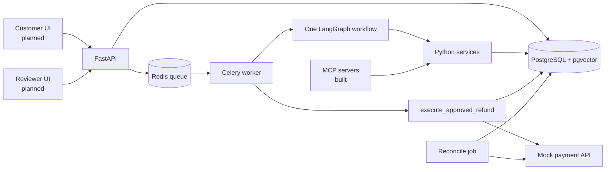
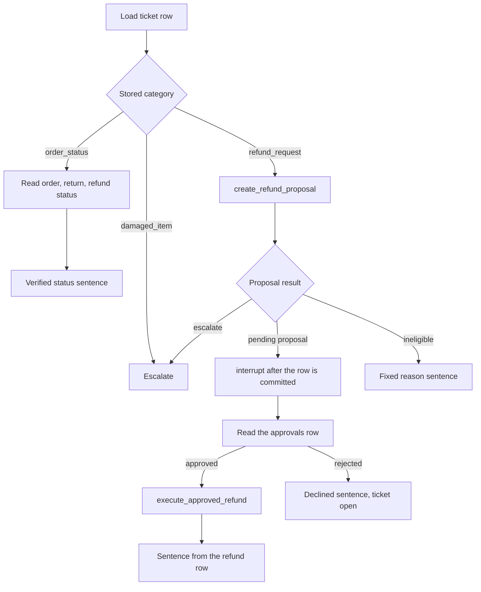
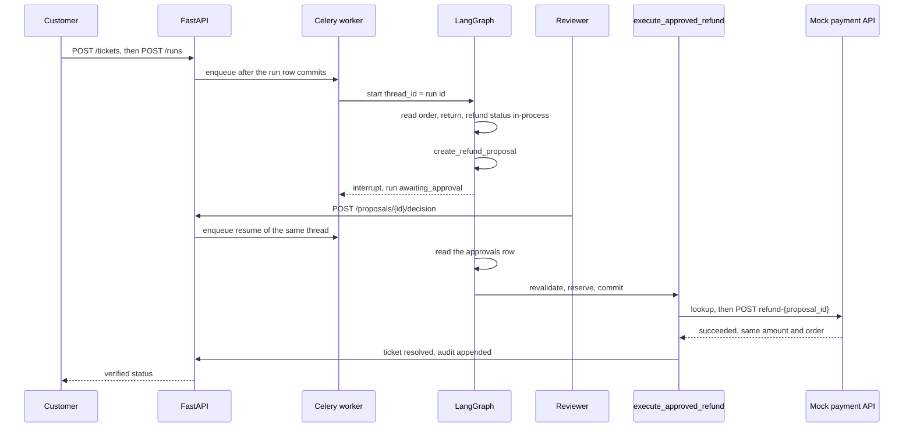
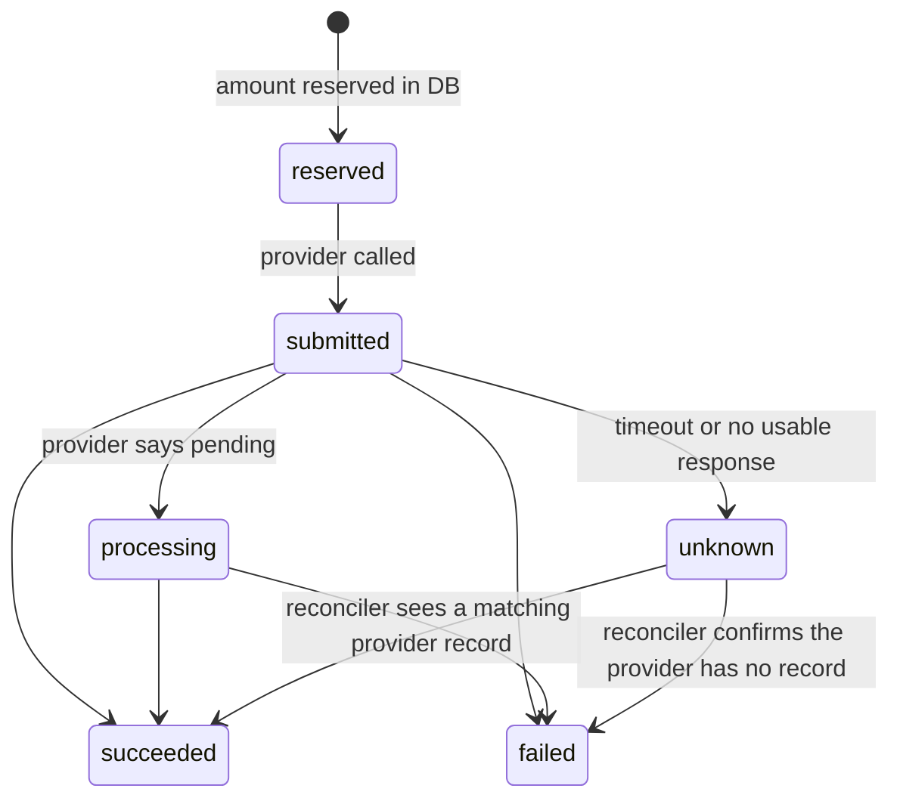

# Architecture

One deterministic LangGraph workflow investigates a ticket. Python decides eligibility,
writes the proposal, and moves money. A human approves every refund. A model may later
draft wording around a sentence the code already chose. That draft is off by default and
is not part of the first workflow.

LangGraph 1.2.24 runs the workflow. `POST /runs` stores the run and enqueues a Celery
task. The task continues that run's `thread_id` and stores checkpoints in schema
`langgraph`. It refuses database `support`. The UI is still planned. The sections
below say which parts already run.

## 1. System overview

The worker calls the order, return, refund-status, policy, and proposal functions
in-process. The customer id comes from the ticket row. The same functions are exposed by
three MCP servers for the Inspector and for a later timing comparison. The first workflow
does not depend on that hop.

`execute_approved_refund` is plain Python. It is not an HTTP route and not an MCP tool.
The worker calls it only after a stored approval. `payments.reconcile` looks up an
open operation by its idempotency key. It has no model and it does not POST a refund.

## 2. What already runs

| Area | In the code now |
|---|---|
| API | `GET /health`, `POST /auth/token`, `GET /me`, `GET /orders`, `GET /orders/{order_id}`, `POST /tickets`, `GET /tickets`, `GET /tickets/{ticket_id}`, `POST /runs`, `GET /proposals`, `GET /proposals/{proposal_id}`, `POST /proposals/{proposal_id}/decision` |
| Ticket | `order_id` and category are required. Category is `order_status`, `refund_request`, or `damaged_item`. |
| MCP | Orders `get_order`, `get_return`, `get_refund_status` on `127.0.0.1:8101`. Policy `search_policy` on `8102`. Actions `create_refund_proposal` on `8103`. |
| Policy | Effective-dated documents, citations, and metadata-only permission. `search_policy` returns `matched` and citations. |
| Proposal | On `support_test`, one `pending_approval` row per run and action type (Alembic `0003`). `create_refund_proposal` also requires the run to be `running` or `awaiting_approval`. The hash covers amount, order, `policy_effect`, and `policy_versions`. |
| Approval | Reviewer or admin, id from the staff row behind the token. Body is `approve` or `reject`. Expires after 24 hours. |
| Payment | Reserve with `SELECT … FOR UPDATE`, commit, look up `refund-{proposal_id}`, then POST. Timeout stores `unknown` and keeps the reserved paise. |
| Runs | `POST /runs` creates one `running` row for the caller's ticket, commits, then enqueues Celery task `workflows.run`. `thread_id` is the string form of the run id. A second call returns the active run and enqueues that same id again. |
| Messages | A refund sentence comes from the refund row. Ineligible, order-status, rejected, and escalated sentences are the code text stored in `tickets.resolution_message` (Alembic `0005`). The customer summary is not that sentence. |
| Workflow | `app/workflows/support_graph.py`. Graph tests use `InMemorySaver`. The worker uses `PostgresSaver`. |
| Worker | `app/worker.py`. The task calls `execute_workflow` with the run id only. It sends `Command(resume=...)` only after an `approvals` row is committed, and the graph ignores that value. |

Database `support` is Alembic `0002` and does not have migration
`0004`. Pytest applies `0004` to `support_test`: partial unique index
`uq_one_active_run_per_ticket` on `workflow_runs (ticket_id)` where status is `running`
or `awaiting_approval`. A successful provider POST is accepted only when the body repeats
the reserved amount and order. A mismatch becomes `unknown` and keeps the reservation.

## 3. Approved workflow

One graph per ticket. There is no second agent.

The stored ticket category selects the branch:

- `order_status` reads the order, return, and refund status and stops. It does not propose a refund.
- `damaged_item` escalates. No damaged-item rule exists yet.
- `refund_request` calls `create_refund_proposal` for that ticket. The function recomputes eligibility and the amount.

`interrupt()` pauses after the proposal commit. Resume uses the same `thread_id`, which
is the string form of the run id. The value passed to `Command(resume=...)` is discarded.
The resume node reads `approvals`. A checkpoint field cannot approve a refund.

The node that calls `interrupt()` runs again from the top on resume, so the proposal
write stays in the earlier node and the payment stays in the later node. Both writes are
idempotent: a second propose returns the existing pending proposal, and a second execute
reuses `refund-{proposal_id}`.

A later optional draft may add wording around the code sentence. Tests leave it off.
The stored customer message still has to contain the code sentence.

### Run lifecycle

`POST /runs` creates one row in `workflow_runs` and enqueues `workflows.run` after commit.
A second call returns the run that is already `running` or `awaiting_approval` and
enqueues that id again.
Migration `0004` is the partial unique index behind that guarantee. Pytest applies it
only to `support_test`. `support` stays on `0002` until a separate approval.

The staff route remains the only approval write. After that commit it enqueues the same
`workflows.run` task. The payload is the run id. A duplicate decision stays a 409 and,
while the run is still `awaiting_approval`, enqueues that id again. If the publish
fails, the decision stays stored and the response is 503. A repeated task after the
run has finished does not pay again. Without an approval row, an interrupt stays paused.

Rejection sets the ticket back to `open` and creates no refund row. The customer sentence
is "A reviewer declined this refund request." `failed` stays the provider failure. The
graph stores the code sentence for ineligible, order-status, rejected, and escalated
outcomes on `tickets.resolution_message`. `GET /tickets` returns that text when the ticket
has no refund row. A refund row still supplies the customer sentence, so a stored sentence
cannot claim a payment the ledger does not confirm.

`GET /proposals` lists `pending_approval` proposals for a reviewer or admin.
`GET /proposals/{id}` returns `proposal_evidence` from the stored payload: order id,
amount in paise, policy effect, policy versions, status, and payload hash. `customer_context`
is a separate object with the ticket id and the customer summary. The summary is plain
text. It is not hashed, not an eligibility input, and not sent to the decision or payment
path. A customer token receives 403. An unknown proposal id is 404. The decision body
remains `approve` or `reject`.

Migration `0005` adds the nullable column. Pytest applies it to `support_test`. `support`
stays on Alembic `0002` until a separate approval.

### Checkpoints

Graph tests use the in-memory saver. The worker uses `PostgresSaver` from
`langgraph-checkpoint-postgres` 3.2.1. That package's `setup()` creates unqualified
tables, so the connection runs `SET search_path TO langgraph` after
`CREATE SCHEMA IF NOT EXISTS langgraph`. The opener raises if the database name or
`current_database()` is `support`, and if a checkpoint table is in `public`.
Checkpoint rows store graph position. Refund accounting stays in
`refund_operations` and `orders.refund_committed_minor`.

### Customer sentences

Ineligible refunds use a fixed sentence for the eligibility reason, plus a policy section
id when one was stored. Citation text is audit evidence. It is not permission and it is
not part of `payload_hash`. When a refund row exists, the customer hears
`verified_customer_message` for that row's status. `submitted`, `processing`,
`succeeded`, `failed`, and `unknown` stay distinct.

## 4. Happy path

`POST /runs` enqueues the worker after commit. The worker runs until the graph pauses
or finishes. A staff decision enqueues the same task, which resumes only from the
stored approval. The proposal, decision, reserve, and provider call already exist.

## 5. Refund operation states

A retry uses the same idempotency key. `payments.reconcile` looks the key up and does
not POST. A matching provider record is copied onto `reserved`, `unknown`, `submitted`,
or `processing`. A mismatched amount or order is audited and left unchanged. Saving
`unknown`, `submitted`, or `processing` publishes `payments.reconcile`. `payments.discover`
publishes every open row again, including a `reserved` row whose worker died before
saving the provider result. Celery Beat publishes that task every 60 seconds.
`RECONCILE_DISCOVER_SECONDS` changes the interval. The schedule carries no amount and
no approval. A lookup timeout leaves the row as it is and the task asks to run again
in 30 seconds, up to 8 times. A confirmed 404 releases only an `unknown` row whose
`updated_at` is at least 2 minutes old, and that release stores `failed`. A younger
`unknown` row stays reserved and is queued again. `reserved`, `submitted`, and
`processing` keep their reservation when the provider has no record. Execution still
does not release `unknown` on a 404. `retry_failed_ticket_updates` resolves a ticket
only when `ticket_update_failed` is newer than any `ticket_update_retried` audit for
that proposal. It does not call the provider. A ticket reopened after that retry stays
open. Every worker pass runs that retry and the open-refund scan.

A provider POST whose amount or order differs from the reservation, or omits either
value, is `ProviderUnavailable`. That stores `unknown` and keeps the reserved paise.
Lookup already refuses a mismatched provider record.

## 6. Trust boundaries

| Boundary | Rule |
|---|---|
| Browser → API | JWT. Customer id and staff id come from the database row behind the token. |
| Ticket → graph | Category and `order_id` come from the ticket row. The summary cannot switch the order or the branch. |
| Graph → services | In-process calls. The customer id is the ticket's customer. |
| MCP clients → MCP | Short-lived customer token, audience `support-mcp`. Tool schemas have no `customer_id`. Another customer's row is a not-found. |
| Graph → money | No tool path. `execute_approved_refund` runs only in the pay node, after the approval row is read. |
| Resume value → approval | Ignored. The `approvals` row is the decision. |
| Policy search → permission | Citations are untrusted text. Permission is metadata on documents effective today. |
| Checkpoint → ledger | Checkpoints remember the thread. Money lives in the application tables. |
